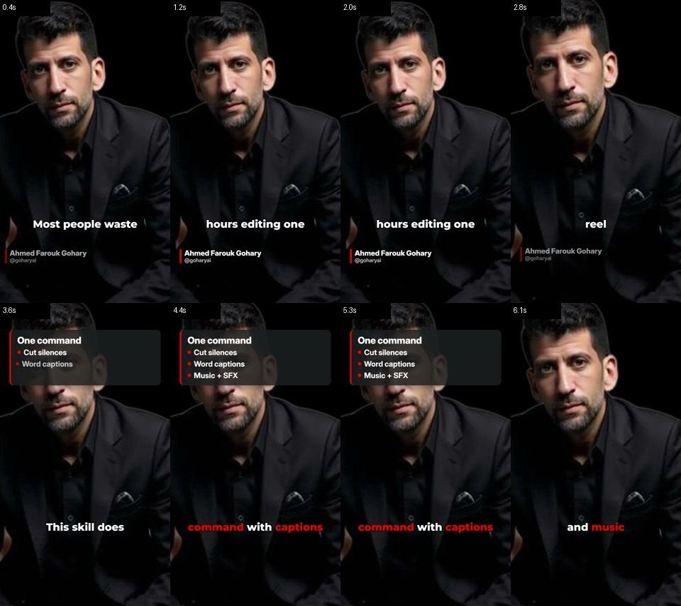
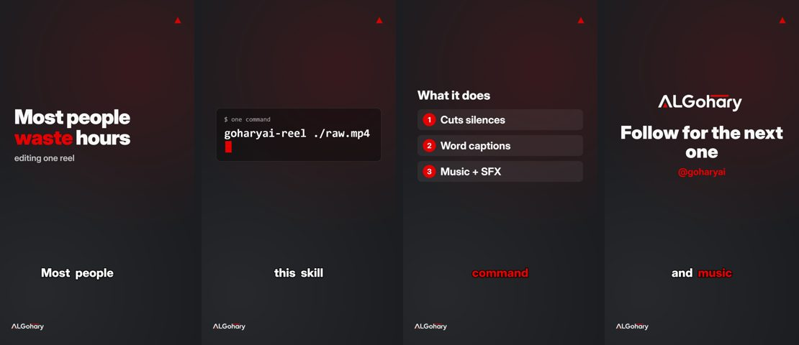
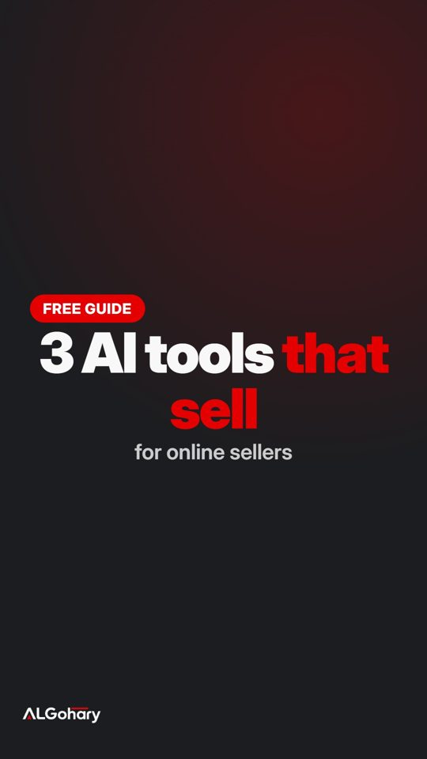
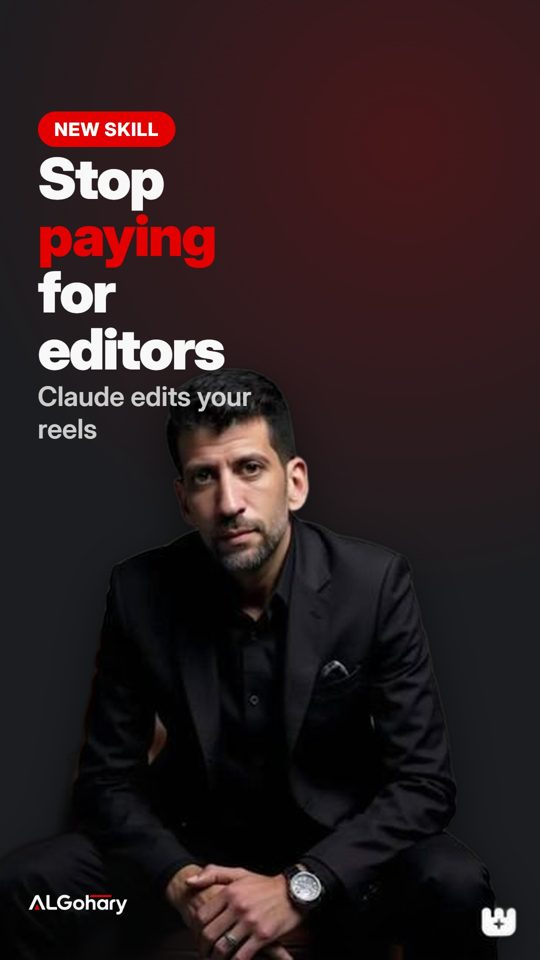
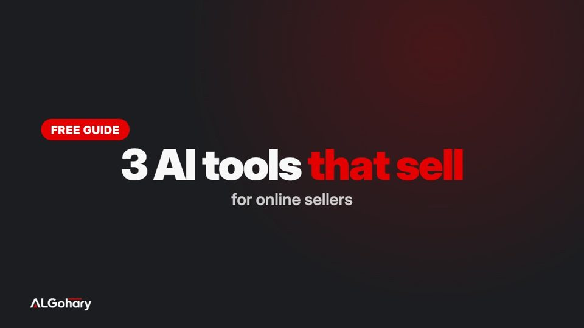
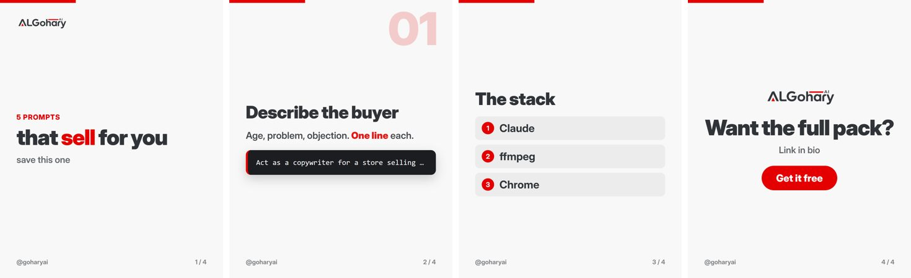

# GoharyAI Skills — video editing skills for Claude Code

Five [Claude Code](https://claude.com/claude-code) skills that turn Claude into a video editor: give it a raw talking-head clip, a folder of hooks and screen recordings, a script, a reference reel, or a post idea — and get back finished, branded, loudness-normalised files. Everything renders locally with **ffmpeg + headless Chrome + Python**; no editing software, no paid APIs.

[العربية](README.ar.md) · by **Ahmed Farouk Gohary** · [@goharyai](https://instagram.com/goharyai)

| Skill | You give | You get |
|---|---|---|
| **goharyai-reel** | a talking-to-camera video | silences removed, word-timed captions (AR/EN), branded motion cards, punch-in zooms, original music, SFX, end card, QA report — 9:16 or 16:9 |
| **goharyai-hook-ads** | hooks/ + demos/ + music/ | every hook × every demo as a separate ad with step captions (4 × 4 = 16 variants), one command |
| **goharyai-motion** | a script or an idea | motion-graphics video with no camera: kinetic text, counters, lists, terminal typing, screenshots, voice-over, music |
| **goharyai-clone** | a reference reel you like | measured analysis (cuts, pacing, type sizes), two routes (original idea / faithful remake), built with your content, side-by-side proof board |
| **goharyai-covers** | a title or a post | reel covers, three thumbnail ideas, Instagram/LinkedIn carousels, background cut-outs |

All five share **goharyai-core**: brand kit, fonts, renderer, transcription, voice, captions, music, mixing and QA. Swap `brand.json` and the logo, and every output is in your brand.

## What it makes

**goharyai-reel** — captions timed to each word, lower-third, bullet card timed to the speech, end card (contact sheet of a finished reel):



**goharyai-motion** — hero text, terminal typing, numbered list, end card, all from a 3-line script and a generated voice:



**goharyai-covers** — reel cover, split cover with a cut-out, YouTube thumbnail, carousel:

<p>
  
</p>



## Install
```bash
git clone https://github.com/Farouk1901/goharyai-skills
cd goharyai-skills
./install.sh            # macOS / Linux
.\install.ps1           # Windows PowerShell
```
The installer copies the skills to `~/.claude/skills/`, runs `npm install` for the renderer and prints an environment check. Requirements:
- **ffmpeg** and **ffprobe** on PATH
- **Node.js 18+** and a Chromium browser (Chrome, Edge or Brave)
- **Python 3.10+** with `pip install faster-whisper numpy soundfile pillow`
- optional: `pip install kokoro soundfile` (offline English voice-over, Python ≤ 3.12), `pip install rembg onnxruntime` (cut-outs)

Then in Claude Code: *"edit this video into a reel"* — or `/goharyai-reel`.

## How it works
- **Speech → words**: faster-whisper gives every word a start and end; captions, cards and scenes are timed to words (`"@word"`), not guessed seconds.
- **Everything is HTML**: cards, scenes, covers and carousels are small HTML pages rendered frame-by-frame in headless Chrome, so Arabic shaping, any font and any CSS just work. Pages are pure functions of time and render in parallel.
- **Original sound**: music is synthesised per video (key, tempo, hits on the cuts) and SFX are generated on a timeline — nothing to license.
- **QA before delivery**: loudness (−16 LUFS), black/frozen frames, and a transcript of the final file compared with the script, so a cut word is caught before you see it.
- **Two deliverables** every time: `final.mp4` and `final_nomusic.mp4` (add a trending sound in the app).

## Use it for your own brand
Copy `skills/goharyai-core/brand.json` into your project folder, change the colours, fonts, handle and logo paths. The skills prefer a project `brand.json` over the core one.

## Repository layout
```
skills/
  goharyai-core/      scripts/ (python + node), templates/ (html), assets/ (fonts OFL, brand), brand.json
  goharyai-reel/      SKILL.md
  goharyai-hook-ads/  SKILL.md
  goharyai-motion/    SKILL.md
  goharyai-clone/     SKILL.md
  goharyai-covers/    SKILL.md
install.sh · install.ps1 · LICENSE (MIT)
```

## License
MIT © 2026 Ahmed Farouk Gohary. Fonts under the SIL Open Font License. The ALGohary AI wordmark is a trademark — replace it with yours.
